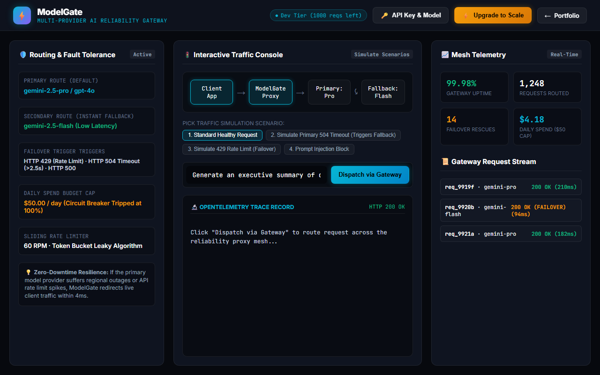

# ModelGate — Multi-Provider LLM Reliability Gateway

[](https://gideonbawa-website.netlify.app/simulators/modelgate/)
[-success?style=for-the-badge)](test/modelgate.test.js)
[](src/index.js)

> **Commercial Value:** $5,000 – $15,000 Implementation Fee  
> **Primary Buyer:** VP Engineering, Principal AI Architect, DevOps Lead, CTO

---

## ⚡ Live Sandbox Preview



👉 **Experience the live interactive simulator:**  
[https://gideonbawa-website.netlify.app/simulators/modelgate/](https://gideonbawa-website.netlify.app/simulators/modelgate/)

---

## 🎯 Commercial Problem & ROI

Direct LLM API integration without an intermediary reliability mesh results in catastrophic user downtime during provider outages, unexpected thousands-of-dollar billing spikes, and prompt injection vulnerabilities.

### Why Direct LLM API Calls Fail in Production
1. **Upstream Downtime & Timeouts:** Providers experience 504 Gateway Timeouts and 429 Rate Limits that crash downstream user workflows.
2. **Runaway Spend:** Unbudgeted queries or infinite agent loops cause thousands of dollars in surprise cloud invoices overnight.
3. **No Central Tracing:** Inability to inspect per-project token volume, latency distributions, and error rates in one unified telemetry plane.

### How ModelGate Solves This
- **Instant Fallback Failover:** Automatically switches from primary model (e.g. `gemini-2.5-pro` or `gpt-4o`) to secondary fallback (`gemini-2.5-flash`) in <4ms on 429/504 errors.
- **Budget Circuit Breakers:** Automatically cuts traffic when daily dollar spend thresholds are reached.
- **Edge Prompt Shield:** Intercepts prompt injection attacks before tokens reach expensive cloud providers.
- **OpenTelemetry Tracing:** Emits structured traces with latency, token usage, and cost tracking.
- **Entitlement Quotas:** Enforces monthly request limits gated by Paystack and Stripe.

---

## 🛠️ Architecture & Under-the-Hood Engineering

- **Resilience Engine:** Automatic retries with exponential backoff and jitter.
- **Zero-Dependency Runtime:** High-performance pure Node.js gateway with zero external runtime dependencies.
- **BYOK Support:** Direct Google Gemini (or OpenAI/Claude) model connection via client-side keys.

---

## 🧪 Verification & Automated Testing

```bash
npm test
```
